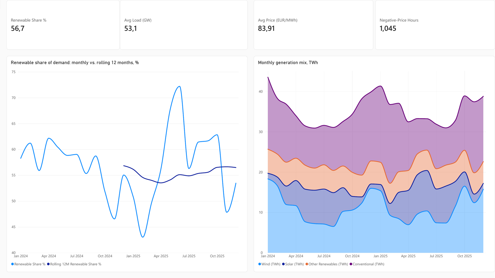
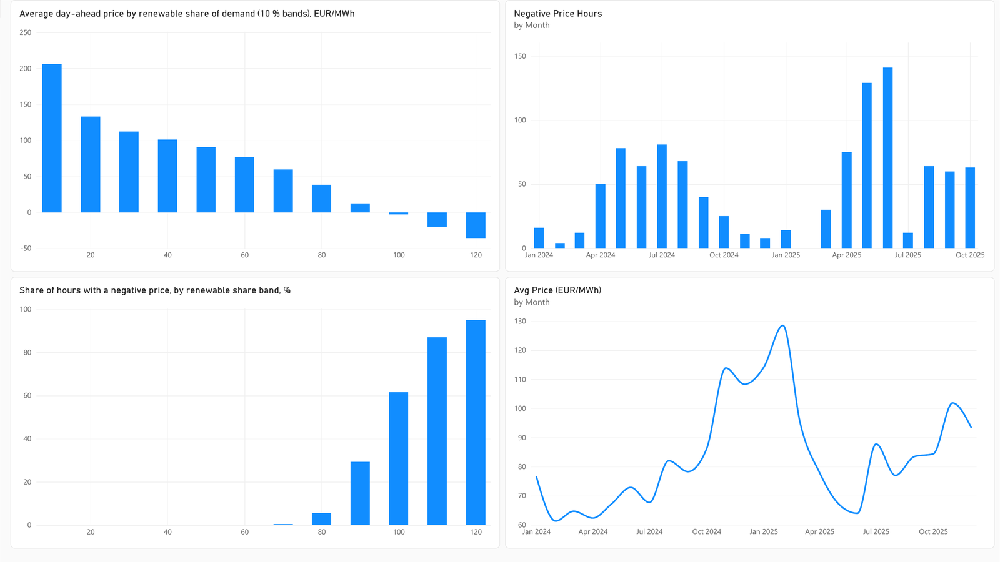
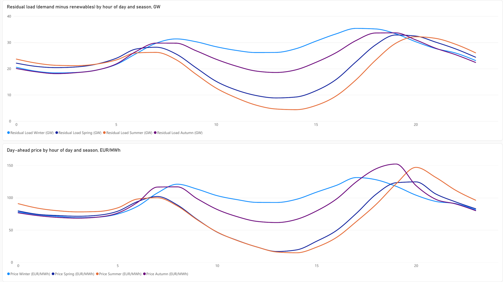

# German Grid Analytics

An end-to-end analytics pipeline over Germany's electricity grid: two public
APIs are extracted daily into Postgres, transformed and tested with dbt, and
served to a Power BI report that answers five concrete questions about the
Energiewende.

Everything runs with `docker compose up`. No API keys, no cloud account, no
manual downloads.


---

## The questions

The pipeline exists to answer these, not to demonstrate tooling:

1. **How is the renewable share of demand actually trending?** Month over
   month and year over year, on a rolling 12-month basis.
2. **How bad is *Dunkelflaute*?** How often does the grid run below 15%
   renewable coverage for six or more consecutive hours, how long do those
   stretches last, and when do they cluster?
3. **What does the real-world wind capacity curve look like?** Hourly output
   against measured wind speed.
4. **Does a high renewable share actually depress the day-ahead price?**
   Price distribution across deciles of renewable share, and the share of
   negative-price hours in each.
5. **When during the day is the grid greenest?** The residual-load duck curve,
   split by season.

The SQL is in [`analysis/insights.sql`](analysis/insights.sql); the answers are
written up in [`docs/findings.md`](docs/findings.md).

---

## The report

A three-page Power BI report ([`powerbi/grid_analytics.pbix`](powerbi/grid_analytics.pbix))
on top of the `marts` star schema, January 2024 – December 2025.

**Overview:** renewable share of demand, monthly against the rolling 12 months, and the
monthly generation mix.



**Prices:** the merit-order effect. The day-ahead price falls with every 10 % band of
renewable share and turns negative above 100 %.



**Daily profile:** the duck curve. Residual load and price by hour of day, one line per
season.



---

## Architecture

```
  Energy-Charts API                Open-Meteo ERA5 API
  (Fraunhofer ISE)                 (hourly weather)
  generation + price                       │
         │                                 │
         └──────────────┬──────────────────┘
                        ▼
              ingestion/ (Python)
              extract → validate → tidy
              idempotent delete-then-insert
                        │
                        ▼
         ┌──────────────────────────────┐
         │  PostgreSQL 16  (Docker)     │
         │                              │
         │  raw ──► staging ──► marts   │
         │           (dbt)              │
         └──────────────────────────────┘
                        │
                        ▼
                    Power BI
              (DirectQuery / Import)
```

Three layers, and each one has a single job:

| Layer | Contains | Materialisation |
|---|---|---|
| `raw` | Untouched API output plus an `ingested_at_utc` stamp | Tables, written only by Python |
| `staging` | Typed, renamed, classified. One model per source. | Views |
| `marts` | Star schema: `fct_grid_hourly`, `fct_daily_summary`, `dim_date` | Tables |

Full reasoning, including the trade-offs I made and their limitations, is in
[`docs/architecture.md`](docs/architecture.md).

---

## Quick start

```bash
git clone https://github.com/AayushKaushik07/german-grid-analytics.git
cd german-grid-analytics

cp .env.example .env          # defaults work for local development

make up                       # start Postgres
make backfill START=2024-01-01 END=2025-12-31
make dbt                      # build models, run 22 data tests
```

Then open [`powerbi/grid_analytics.pbix`](powerbi/grid_analytics.pbix) and click
**Refresh**, or connect your own report to `127.0.0.1:5432`, database `grid`, schema
`marts`. Details in [`powerbi/README.md`](powerbi/README.md).

To run it daily, one cron line is enough — the loads are idempotent, so a
retried or overlapping run cannot duplicate data:

```cron
30 6 * * *  cd /path/to/german-grid-analytics && make ingest && make dbt
```

---

## Data sources

| Source | What | Grain | Licence |
|---|---|---|---|
| [Energy-Charts](https://api.energy-charts.info) (Fraunhofer ISE) | Generation by production type, load, day-ahead prices | 15 min | CC BY 4.0 |
| [Open-Meteo](https://open-meteo.com) ERA5 archive | Temperature, wind speed at 100 m, solar radiation, cloud cover | 1 hour | CC BY 4.0 |

Both are public and keyless. Data goes back to 2015 and beyond, so the
backfill range is a matter of patience rather than access.

---

## The parts that were actually hard

Worth reading if you're evaluating this as engineering work rather than as a
tutorial follow-along.

**Daylight saving time.** German data is published in local time, which has one
duplicated hour every October and one missing hour every March. Storing local
timestamps would silently create duplicate primary keys twice a year. Everything
is normalised to UTC on ingest, and `Europe/Berlin` local time is *derived* in
the marts layer for reporting. The `hours_observed` test on `fct_daily_summary`
accepts 23–25 rather than exactly 24, precisely because those two days are
legitimate exceptions rather than data errors.

**Mixed grain across sources.** Generation arrives at 15-minute resolution,
weather at hourly. Rather than throwing away three quarters of the generation
data on ingest, both are landed at native grain and reconciled in
`int_generation_hourly`.

**Aggregation order.** The API returns instantaneous power in MW, not energy.
Summing four 15-minute values inside an hour inflates the total fourfold.
Renewable and conventional totals are therefore summed *within* each timestamp
first and averaged across the hour second. This is the kind of error that
produces a plausible-looking dashboard with numbers that are wrong by exactly
400%, so the ordering is commented in the model.

**Non-generation series hiding inside the detail feed.** `Load`, `Residual load`
and the renewable-share series arrive in the same `production_types` array as
real generators, and so do net cross-border trade (negative when Germany exports)
and the power drawn by pumped storage (always negative). Summing the array
naively double counts demand as generation and subtracts exports from it. All of
them are flagged with `is_aggregate_series` in staging and excluded from every
total. The last two only showed up in the real data, so a dbt test now fails the
build if conventional generation ever goes negative again, and another one fails
if a renamed production type (the source spells it `lignite`, not `Lignite`)
leaves a column empty.

**Testing without a live dependency.** CI seeds a deterministic synthetic slice
([`scripts/seed_ci_data.py`](scripts/seed_ci_data.py)) with realistic diurnal
and weekly shapes, so `dbt build` exercises the real models and the real tests
without an upstream outage turning every pull request red.

---

## Data quality

`make dbt` runs the models and their tests in one command; a failing test fails
the build. Coverage:

- **Uniqueness and not-null** on every primary key across staging and marts
- **Range tests** on load, renewable share, wind speed, and hours-per-day —
  set to `warn` where a value can be surprising but legitimate (negative
  prices are real and must not fail the build)
- **Source freshness**: warn at 36 hours, error at 72
- **Structural validation in Python**: `parse_public_power` refuses to load a
  series whose value array is misaligned with its timestamp array, rather than
  letting pandas pad it with nulls

12 Python unit tests cover the parsing layer, all offline.

---

## Repository layout

```
ingestion/          Extract and load
  api_clients.py    HTTP with retry and backoff
  transform.py      Pure JSON → DataFrame functions (no I/O, fully tested)
  loaders.py        Idempotent delete-then-insert into Postgres
  run_ingest.py     CLI: --start / --end, chunked by 90 days

dbt/models/
  staging/          Typing, renaming, classification (views)
  intermediate/     Hourly resampling and pivoting (ephemeral)
  marts/            Star schema for Power BI (tables)

analysis/insights.sql   The five questions, as window-function SQL
scripts/                CI seed data generator
sql/ddl/                Schema and index DDL
tests/                  pytest suite
powerbi/                Power BI report (.pbix), screenshots, how to connect
docs/                   Architecture, data dictionary, findings
.github/workflows/      Lint → test → seed → dbt build
```

---

## Tech

Python 3.12 · PostgreSQL 16 · dbt-core 1.9 · Docker Compose · GitHub Actions ·
Power BI · pandas · SQLAlchemy · pytest · ruff

---

## Licence

MIT for the code. The data is CC BY 4.0 from Fraunhofer ISE and Open-Meteo;
attribution is retained in the report and in `docs/data_dictionary.md`.
